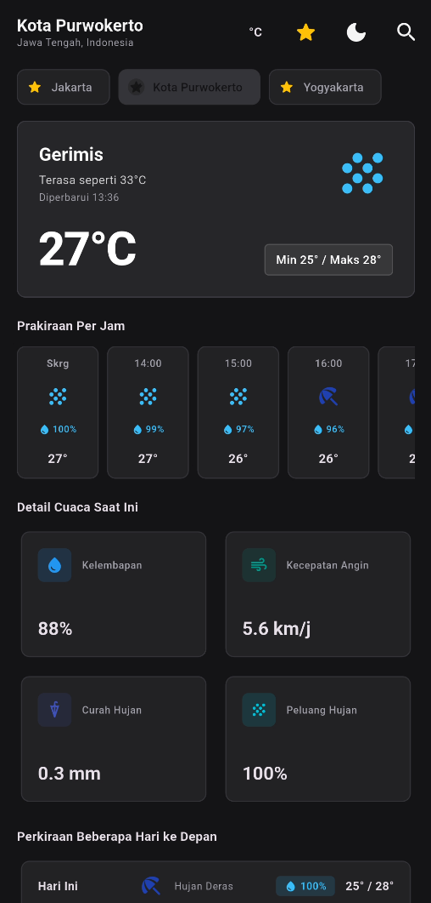
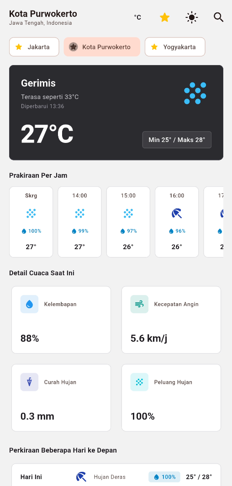
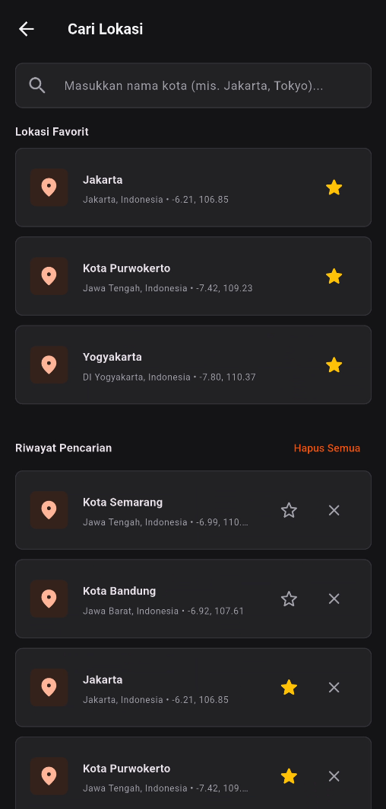
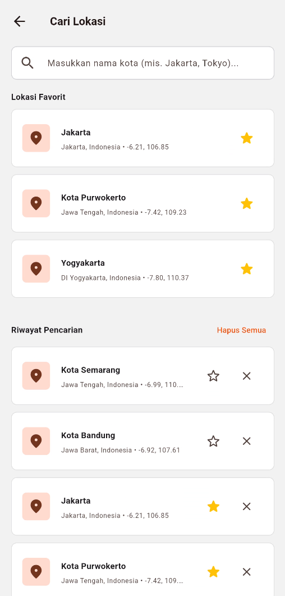

# SimpleWeather

Aplikasi informasi cuaca berbasis Flutter dengan arsitektur **MVVM (Model-View-ViewModel)** yang mengambil data cuaca terkini, prakiraan per jam, dan prakiraan harian secara *real-time* dari **Open-Meteo API**, serta menyimpan lokasi favorit, riwayat pencarian, tema, dan satuan suhu (`°C` / `°F`) menggunakan **SharedPreferences**.

## Identitas Mahasiswa

- **Nama**: Nuh Elang Yusarsadam
- **NIM**: H1D024070
- **Shift**: D (KRS: A)
- **Mata Kuliah**: Praktikum Pemrograman Mobile

## Fitur Utama

- **Cuaca Terkini & Timestamp**: Menampilkan kondisi cuaca (`weather_code`), suhu saat ini, suhu terasa, kelembapan, kecepatan angin, curah hujan, peluang hujan, serta waktu pembaruan terakhir.
- **Prakiraan Per Jam & Harian**: Daftar geser prakiraan 24 jam ke depan dan prakiraan beberapa hari ke depan.
- **Pencarian Kota & Favorit**: Pencarian kota secara *real-time* melalui Open-Meteo Geocoding API, penyimpanan lokasi favorit, dan riwayat pencarian lokal.
- **Personalisasi**: Dukungan Light & Dark Theme bergaya abu-abu gelap modern serta pengubah satuan suhu `°C` / `°F`.

## Struktur Aplikasi (MVVM)

```text
lib/
├── main.dart                         # Entry point & konfigurasi MultiProvider + MaterialApp
├── models/
│   ├── location_model.dart           # Model data lokasi (Geocoding & Local Storage)
│   └── weather_model.dart            # Model data cuaca (Current, Hourly, Daily, WeatherCodeInfo)
├── services/
│   ├── weather_api_service.dart      # HTTP GET ke Open-Meteo Forecast & Geocoding API
│   └── local_storage_service.dart    # Penyimpanan lokal (favorit, riwayat, lokasi terakhir, tema, unit)
├── viewmodels/
│   ├── weather_viewmodel.dart        # State management layar Home (cuaca, favorit, tema, unit)
│   └── search_viewmodel.dart         # State management layar Search (pencarian kota, riwayat)
├── theme/
│   └── app_theme.dart                # Konfigurasi Material 3 Light & Dark Theme + Typography
├── views/
│   ├── home_screen.dart              # Home / Weather Screen
│   └── search_screen.dart            # Search / Location Screen
└── widgets/
    ├── weather_detail_card.dart      # Kartu metrik detail cuaca (kelembapan, angin, hujan)
    ├── hourly_forecast_list.dart     # Daftar geser prakiraan per jam
    ├── daily_forecast_tile.dart      # Baris prakiraan cuaca harian
    └── location_tile.dart            # Item daftar kota (hasil pencarian, favorit, riwayat)
```

## Penerapan MVVM

- **Model (`models/` & `services/`)**: Merepresentasikan struktur data dari JSON (`LocationModel`, `WeatherModel`) serta menangani pengambilan data eksternal (`WeatherApiService`) dan penyimpanan lokal (`LocalStorageService`).
- **ViewModel (`viewmodels/`)**: Menggunakan `ChangeNotifier` dari package `provider` (`WeatherViewModel` dan `SearchViewModel`) untuk mengelola state (`isLoading`, `errorMessage`, data cuaca, favorit, riwayat pencarian, satuan suhu), memanggil service, dan memicu pembaruan UI melalui `notifyListeners()`.
- **View (`views/` & `widgets/`)**: `HomeScreen` dan `SearchScreen` hanya bertugas merender UI berdasarkan state dari ViewModel (`context.watch` / `context.select`) dan meneruskan aksi pengguna ke ViewModel (`context.read`).

## Implementasi Open-Meteo API

Aplikasi menggunakan HTTP `GET` melalui package `http` ke dua endpoint resmi Open-Meteo:

1. **Weather Forecast API**:
   `https://api.open-meteo.com/v1/forecast`
   - Parameter: `latitude`, `longitude`, `current`, `hourly`, `daily`, `timezone=auto`
   - Field `current`: `temperature_2m`, `apparent_temperature`, `relative_humidity_2m`, `precipitation`, `weather_code`, `wind_speed_10m`
   - Field `hourly`: `temperature_2m`, `weather_code`, `precipitation_probability`
   - Field `daily`: `weather_code`, `temperature_2m_max`, `temperature_2m_min`, `precipitation_probability_max`

2. **Geocoding API**:
   `https://geocoding-api.open-meteo.com/v1/search`
   - Parameter: `name`, `count=10`, `language=id`, `format=json`
   - Digunakan pada fitur pencarian kota secara *real-time* untuk mendapatkan koordinat (`latitude`, `longitude`) kota yang dipilih pengguna.

## Screenshot Aplikasi

| Home (Dark) | Home (Light) |
| :---: | :---: |
|  |  |

| Search (Dark) | Search (Light) |
| :---: | :---: |
|  |  |

## Pembuat & Lisensi

- **Author**: Nuh Elang Yusarsadam (`mr-elang`)
- **Data Cuaca**: Disediakan oleh [Open-Meteo](https://open-meteo.com/)
- **Lisensi**: Proyek ini bersifat *open source* di bawah lisensi [MIT License](LICENSE).
